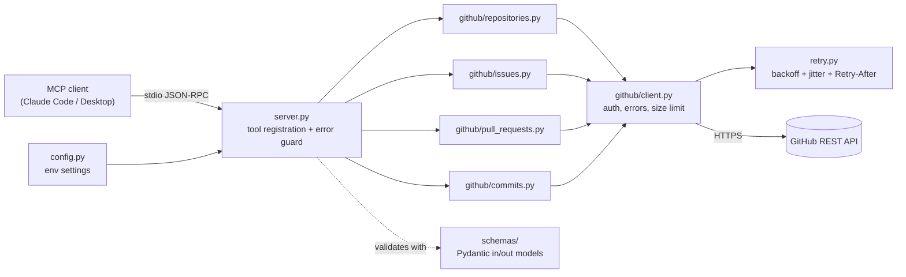

# GitMCP

**A GitHub server for AI assistants: lets Claude and other MCP clients read repositories, issues, pull requests
and commits through validated tools, with writes disabled unless you opt in.**

[](https://github.com/wablevaibhav/gitmcp/releases#release-v0.1.0)


- 14 read-only tools plus 4 opt-in write tools, each with a strict Pydantic input schema
- Transient failures (429, 5xx, timeouts) are retried within a hard budget; auth, permission and 404 errors never are
- Safe by default: writes off, token never logged or returned, response sizes capped, no arbitrary URL/shell access
- Works with Claude Code and Claude Desktop over stdio; public repos need no token

> **Honest expectations:** stdio only, so each user runs their own local copy. Code search and private
> repositories need a GitHub token. File reads are UTF-8 text only.

## What I built

GitMCP is a Python MCP server that adapts the GitHub REST API into 18 tools an AI assistant can discover and
call. The GitHub logic (`github/*.py`) is independent of MCP, so it is tested without a running server; a thin
`server.py` registers the tools and turns every failure into a short, safe, actionable message. It was
built against the current official MCP Python SDK (2.x) and verified with a real MCP stdio client.

## Results at a glance

Measured on a Windows 11 laptop, Python 3.14, anonymous (no token) against the live GitHub API.

| Metric | Result |
| ------ | ------ |
| Automated tests | 112 passing, 1 skipped (live integration test, needs a token), ~13 s |
| Lint / types | `ruff` clean, `mypy --strict` clean (18 source files) |
| Cold start: spawn process, MCP handshake, list 14 tools | 1.3 s |
| `github_get_repository` latency | 0.6 s first call (TLS setup), ~0.02 s median on reused connection |
| Code size | ~2,100 lines in `src/`, ~1,400 lines of tests |

Latency is dominated by GitHub and the network, not by the server. Design trade-offs are in
[DECISIONS.md](DECISIONS.md).

## Architecture



| Module | Responsibility |
|---|---|
| `server.py` | Creates the `MCPServer`, registers tools, converts errors to safe tool errors, closes the HTTP client on shutdown |
| `github/*.py` | Business logic. No MCP imports, so it is testable without a server |
| `github/client.py` | Authenticated `httpx` client, HTTP status → typed error mapping, response-size cap |
| `retry.py` | Retry policy (429 / 5xx / network), `Retry-After` and reset-header handling |
| `schemas/` | Strict Pydantic input models (`extra="forbid"`) and output models |
| `errors.py` | Typed exceptions with safe messages and hints |
| `logging_utils.py` | stderr logging with secret redaction |

Why it is built this way: see [DECISIONS.md](DECISIONS.md).

## Quick start

Requires **Python 3.11+**. Repository: <https://github.com/wablevaibhav/gitmcp>

```bash
python -m pip install git+https://github.com/wablevaibhav/gitmcp
python -m gitmcp          # starts the server (waits silently for an MCP client)
```

Then connect it to your AI client: see [Claude Code](#claude-code) or [Claude Desktop](#claude-desktop).
You do not need to clone the repository to *use* GitMCP.

**Latest release:** [v0.1.0](https://github.com/wablevaibhav/gitmcp/releases#release-v0.1.0). To install exactly
that version:

```bash
python -m pip install git+https://github.com/wablevaibhav/gitmcp@v0.1.0
```

To upgrade later:

```bash
python -m pip install --upgrade --force-reinstall git+https://github.com/wablevaibhav/gitmcp
```

Alternatives (not required): `pipx install git+https://github.com/wablevaibhav/gitmcp`, or with
[uv](https://docs.astral.sh/uv/): `uvx --from git+https://github.com/wablevaibhav/gitmcp gitmcp`.

### Development install (contributors)

```bash
git clone https://github.com/wablevaibhav/gitmcp.git
cd gitmcp
python -m venv .venv
# Windows (PowerShell):  .venv\Scripts\Activate.ps1
# macOS / Linux:         source .venv/bin/activate
pip install -e ".[dev]"
```

`requirements-lock.txt` pins the exact versions the project was tested with
(`pip install -r requirements-lock.txt`, then `pip install -e . --no-deps`).

## GitHub token setup

The token is optional for public repositories (anonymous limit: 60 requests/hour) but required for private
repositories, **code search**, and write tools.

Create a **fine-grained personal access token** at *GitHub → Settings → Developer settings → Personal access
tokens → Fine-grained tokens*, restricted to only the repositories you want the assistant to see.

| Capability | Repository permission |
|---|---|
| Repos, contents, file reading, commits | Contents: **Read** (Metadata: Read is implicit) |
| Issues and comments | Issues: **Read** |
| Pull requests, files, reviews | Pull requests: **Read** |
| `github_create_issue`, `github_add_issue_comment` | Issues: **Read and write** |
| `github_create_branch` | Contents: **Read and write** |
| `github_create_pull_request` | Pull requests: **Read and write** |

Start with read-only permissions. Add write permissions only if you enable write tools.

**Public vs. authenticated:** without a token only public data is visible and GitHub returns `404` for private
resources. With a token you see exactly what the token can see, nothing more; GitMCP never bypasses GitHub's
authorization.

## Configuration

Environment variables (or a `.env` file in the working directory; copy `.env.example`):

| Variable | Default | Meaning |
|---|---|---|
| `GITHUB_TOKEN` | *(none)* | Personal access token |
| `GITHUB_API_URL` | `https://api.github.com` | API base (GitHub Enterprise: `https://HOST/api/v3`) |
| `GITHUB_API_VERSION` | `2022-11-28` | `X-GitHub-Api-Version` header |
| `GITHUB_REQUEST_TIMEOUT` | `30` | Per-request timeout, seconds |
| `GITHUB_MAX_RETRIES` | `3` | Retries after the first attempt (0–10) |
| `GITHUB_MAX_RATE_LIMIT_WAIT` | `60` | Longest rate-limit wait GitMCP will sleep through, seconds |
| `GITHUB_ENABLE_WRITE_TOOLS` | `false` | Register write tools |
| `GITMCP_LOG_LEVEL` | `INFO` | `DEBUG`/`INFO`/`WARNING`/`ERROR` (stderr) |
| `GITMCP_MAX_FILE_BYTES` | `200000` | Largest file `github_get_file_contents` returns |
| `GITMCP_MAX_PATCH_CHARS` | `8000` | Per-file diff truncation |
| `GITMCP_MAX_COMMENT_CHARS` | `4000` | Comment/review body truncation |
| `GITMCP_MAX_RESPONSE_BYTES` | `5000000` | Hard cap on any GitHub response body |

## Running the server

```bash
python -m gitmcp          # or simply: gitmcp
```

The server speaks MCP over **stdio**, so on its own it prints a "ready" line to stderr and waits. It is meant
to be launched by an MCP client. To confirm it is discoverable and callable using a real MCP stdio client
(from a clone of this repo):

```bash
python scripts/verify_tools.py                       # lists the tools
python scripts/verify_tools.py octocat/Hello-World   # also calls github_get_repository
```

> **Keep your token secret.** Never paste it into chats, issues, screenshots or commit it. If a token is ever
> exposed, revoke it immediately at <https://github.com/settings/personal-access-tokens> and create a new one.

### Claude Code

**macOS / Linux / Git Bash:**

```bash
claude mcp add gitmcp --scope user -e GITHUB_TOKEN="$GITHUB_TOKEN" -- python -m gitmcp
```

**Windows PowerShell** (Windows PowerShell 5.1 swallows the `--` separator, so run through `cmd`):

```powershell
$env:GITHUB_TOKEN = "your-token"       # type it in your own terminal only
cmd /c "claude mcp add gitmcp --scope user -e GITHUB_TOKEN=%GITHUB_TOKEN% -- python -m gitmcp"
```

Verify with `claude mcp list` (or `/mcp` inside Claude Code). If `python` is not the interpreter you installed
GitMCP into, use its full path (`where python` / `which python`), e.g.
`C:\Users\you\AppData\Local\Programs\Python\Python312\python.exe`.

You can also share a project-level `.mcp.json`, referencing each person's own environment variable (never
write the token into the file):

```json
{
  "mcpServers": {
    "gitmcp": {
      "command": "python",
      "args": ["-m", "gitmcp"],
      "env": { "GITHUB_TOKEN": "${GITHUB_TOKEN}" }
    }
  }
}
```

### Claude Desktop

Edit `claude_desktop_config.json` (Windows: `%APPDATA%\Claude\`, macOS:
`~/Library/Application Support/Claude/`), then restart Claude Desktop:

```json
{
  "mcpServers": {
    "gitmcp": {
      "command": "python",
      "args": ["-m", "gitmcp"],
      "env": {
        "GITHUB_TOKEN": "your-token",
        "GITHUB_ENABLE_WRITE_TOOLS": "false"
      }
    }
  }
}
```

If Claude Desktop cannot find `python`, set `command` to the full interpreter path, with doubled backslashes
on Windows (`"C:\\Users\\you\\AppData\\Local\\Programs\\Python\\Python312\\python.exe"`).

### Using it with others

Each person runs their own local copy; no server is shared and tokens are never shared. Everyone does:

1. `python -m pip install git+https://github.com/wablevaibhav/gitmcp`
2. Creates **their own** fine-grained GitHub token (see below).
3. Adds the server to their client using one of the configurations above.

Public repositories work without a token (60 requests/hour); private repositories, code search and write
tools require one.

> Installing the package does not make the server appear in a client by itself; the client must be configured
> as above. The server and command were verified with `scripts/verify_tools.py` (a real MCP stdio client). The
> Claude Code / Desktop snippets follow those products' documented formats.

## Usage

Real output from `python scripts/verify_tools.py octocat/Hello-World` (an MCP client talking to the server
over stdio, no token):

```text
Connected. 14 tools:
  - github_search_repositories
  - github_get_repository
  - github_list_repository_contents
  - github_get_file_contents
  ...
is_error: False
{'full_name': 'octocat/Hello-World', 'owner': 'octocat', 'name': 'Hello-World',
 'visibility': 'public', 'stars': 3842, 'default_branch': 'master', ...}
```

Errors are short, typed and actionable (real output, anonymous):

```text
github_get_repository  -> NotFoundError: Resource not found. Hint: Check owner, repo, path and ref.
                          Private resources also return 404 when the token lacks access.
                          No GITHUB_TOKEN is configured, so only public data is visible.
github_search_code     -> AuthenticationError: GitHub code search requires authentication.
                          Hint: Set GITHUB_TOKEN, and scope the query with repo:, org: or user:.
```

## Tools

Every tool takes **one object argument named `params`**. All inputs reject unknown fields. List tools accept
`page` (1–1000) and `per_page` (1–100, default 30) and return `has_next_page`. `owner`/`repo`/`ref`/`path` are
validated (no traversal, no invalid ref characters).

| Tool | Key arguments | Returns |
|---|---|---|
| `github_search_repositories` | `query`, `language`, `topic`, `min_stars`, `sort`, `order`, paging | total count; items with full name, owner, description, URL, visibility, language, stars, default branch |
| `github_get_repository` | `owner`, `repo` | summary + license, forks, open issues, topics, clone/API URLs, timestamps |
| `github_list_repository_contents` | `owner`, `repo`, `path`, `ref` | entries: name, path, type, size, sha, web/API/download URLs |
| `github_get_file_contents` | `owner`, `repo`, `path`, `ref` | UTF-8 `content`, sha, size. Errors for directories, binary, > size limit |
| `github_search_code` | `query` (needs `repo:`/`org:`/`user:`), paging | items: path, repository, URL, snippets. Requires token |
| `github_list_issues` | `owner`, `repo`, `state`, `labels`, `assignee`, `include_pull_requests`, paging | summaries with `is_pull_request` flag |
| `github_get_issue` | `owner`, `repo`, `issue_number` | details: body, labels, assignees, milestone, timestamps, URL |
| `github_list_issue_comments` | `owner`, `repo`, `issue_number`, paging | comments (bodies truncated, flagged) |
| `github_list_pull_requests` | `owner`, `repo`, `state`, `base`, `head` (`owner:branch`), paging | PR summaries |
| `github_get_pull_request` | `owner`, `repo`, `pull_number` | branches, SHAs, author, draft/merged/mergeable, size, reviewers |
| `github_list_pull_request_files` | `owner`, `repo`, `pull_number`, paging | files: status, +/−, patch (truncated, flagged) |
| `github_list_pull_request_reviews` | `owner`, `repo`, `pull_number`, paging | reviews: author, `APPROVED`/`CHANGES_REQUESTED`/…, body |
| `github_list_commits` | `owner`, `repo`, `ref`, `path`, `author`, paging | commit summaries |
| `github_get_commit` | `owner`, `repo`, `ref` | message, author, parents, stats, files (max 100, patches truncated) |
| `github_create_issue` ⚠ | `owner`, `repo`, `title`, `body`, `labels`, `assignees` | number, URL |
| `github_add_issue_comment` ⚠ | `owner`, `repo`, `issue_number`, `body` | comment id, URL |
| `github_create_branch` ⚠ | `owner`, `repo`, `branch`, `from_ref` | new ref, SHA |
| `github_create_pull_request` ⚠ | `owner`, `repo`, `title`, `head`, `base`, `body`, `draft` | number, URL |

⚠ Write tool: registered only when `GITHUB_ENABLE_WRITE_TOOLS=true`.

## Example prompts

- *Repository exploration:* "Look at `octocat/Hello-World`. What's the default branch, what's in the root, and what
  does the README say?"
- *Code search:* "Find where `parse_config` is defined in `acme/api`." (needs a token)
- *Issue investigation:* "List open issues labeled `bug` in `acme/api`, then summarize the discussion on the
  most-commented one."
- *PR review:* "Review PR 482 in `acme/api`: show the metadata, the changed files and patches, existing reviews,
  and point out risky changes."
- *History:* "Who last touched `src/auth.py` in `acme/api` and what did those commits change?"

## Rate limits and error handling

| Situation | Behavior |
|---|---|
| `429`, or `403` with rate-limit signals | Retried, honoring `Retry-After` / `x-ratelimit-reset`. If the wait exceeds `GITHUB_MAX_RATE_LIMIT_WAIT`, fails immediately with `RateLimitError` stating the wait. Never sleeps past that limit |
| `500/502/503/504`, timeouts, connection errors | Retried up to `GITHUB_MAX_RETRIES` with exponential backoff and full jitter (0.5 s base, 8 s cap) |
| `401` | `AuthenticationError` — no retry |
| `403` (permission) | `AuthorizationError` — no retry, hint names the permission to grant |
| `404` | `NotFoundError` — no retry; hint notes private resources also return 404 |
| `400/409/422` | `InputValidationError` — no retry |
| Malformed / oversized / non-JSON body | `GitHubAPIError` |

Write requests (POST) are never replayed after a timeout or 5xx, since the write may have succeeded; they are
only retried when GitHub rejected them with a rate limit.

Clients receive `ErrorType: message Hint: ...`. Tracebacks, response bodies and tokens never reach the client.

## Security

- The token comes only from the environment, is held as a `SecretStr`, and is redacted from logs and errors
  (exact-match plus `ghp_…`/`github_pat_…`/`Authorization:` patterns).
- Write tools are not registered unless `GITHUB_ENABLE_WRITE_TOOLS=true`, and each write service method refuses
  independently if the flag is off. GitHub still enforces the token's own permissions.
- No shell execution, no arbitrary URL fetching, no GraphQL, no generic API proxy: every tool maps to a fixed
  REST endpoint and tool arguments are percent-encoded into the path.
- File, patch, comment and total response sizes are capped; logs never contain source code or full responses.
- Use a fine-grained token scoped to specific repositories, and set an expiry.
- Streamable HTTP transport is intentionally **not** implemented; a network-exposed server would need its own
  authentication, which is out of scope for this release.

## Development

From a development install:

```bash
pytest                       # unit + MCP tests (no token, no network)
ruff check . && ruff format --check .
mypy                         # strict, on src/
```

Optional live tests (read-only, skipped unless configured):

```bash
GITMCP_TEST_TOKEN=github_pat_xxx GITMCP_TEST_REPO=owner/repo pytest -m integration
```

## Troubleshooting

| Symptom | Likely cause / fix |
|---|---|
| Client shows no tools | Wrong Python in client config. Run `python -m gitmcp` with that exact interpreter; use its full path in the config |
| `error: unknown option '-m'` (PowerShell) | PowerShell 5.1 drops `--`. Use the `cmd /c "claude mcp add ..."` form above |
| `No module named gitmcp` | Installed into a different Python/venv than the one the client launches |
| `NotFoundError` on a repo you can open in a browser | Private repo and missing/under-scoped token |
| `AuthorizationError` | Token lacks the permission in the table above or the repo isn't selected for the token |
| `RateLimitError` immediately | Reset is further away than `GITHUB_MAX_RATE_LIMIT_WAIT`; set a token or wait |
| `github_search_code` fails | Needs `GITHUB_TOKEN` and a `repo:`/`org:`/`user:` qualifier |
| Write tools missing | Intentional: set `GITHUB_ENABLE_WRITE_TOOLS=true` and restart the client |
| `invalid configuration` on start | A setting failed validation; field names are printed to stderr |
| Garbled protocol output | Something wrote to stdout; use stderr for any debugging |

## Limitations and roadmap

- Read tools return the first slice of a result (paging is explicit); there is no automatic follow-all-pages.
- File contents are UTF-8 text only; binary files and files over `GITMCP_MAX_FILE_BYTES` are refused.
- Code search depends on GitHub's search index and its limits (max 1000 results, query ≤ 256 chars).
- `github_get_commit` caps files at 100 and does not page GitHub's commit-file pagination.
- GitHub Actions, releases, review comments (inline), and Projects are not covered.
- stdio only; planned: authenticated Streamable HTTP, conditional-request (ETag) caching, repository tree tool.
- Python 3.14 and `mcp` 2.3 were used for development; the code targets Python ≥ 3.11.
